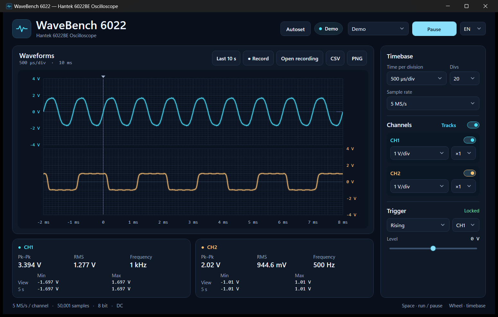

# WaveBench 6022

**A Windows oscilloscope app for the Hantek 6022BE.** Capture both channels over USB, save an event you just saw, and inspect it later with measurements, cursors, and search.

[Download the latest Windows x64 release](https://github.com/9PK4U/wavebench-6022/releases/latest)



## Features

| Live capture | Recording and review |
| --- | --- |
| Two channels, configurable timebase, 4–50 horizontal divisions, and up to 15 MS/s per channel | Start/stop recording or save up to the last 10 seconds from the recent capture buffer |
| Rising/falling software trigger, Autoset, and overlaid or split tracks | Seek, play, step through frames, zoom, and measure with A/B cursors |
| Peak-to-peak, RMS, frequency, and separate Min/Max values for the view and the last 5 seconds | Search for threshold crossings or short positive pulses and jump to the matching event |
| English by default, with an **EN / RU** switch that remembers your selection | Export visible samples or a cursor region to CSV, and save the live plot as PNG |

## Get started

1. Download the Windows x64 ZIP from [Releases](https://github.com/9PK4U/wavebench-6022/releases/latest), extract it, and run `WaveBench6022.exe`. You can also [build it from source](#build-from-source).
2. Connect the Hantek 6022BE. WaveBench starts capturing when it sees the device, and opens **Demo** when it cannot find it. The source selector also lets you choose either mode.
3. Select **Autoset** to pick the signal channel, set the trigger level, and fit several periods when the frequency can be measured.

Windows needs **WinUSB** for both USB device IDs, `04B4:6022` before firmware upload and `04B5:6022` after enumeration. Close other oscilloscope software before opening the device. WaveBench loads the firmware into the oscilloscope’s RAM when needed. [Signed driver and installation instructions from OpenHantek](https://github.com/OpenHantek/OpenHantek6022/blob/main/docs/build.md#signed-winusb-driver-for-hantek-6022bebl)

### Controls

| Action | Control |
| --- | --- |
| Run or pause live capture | **Space** or **Pause / Resume** |
| Adjust the live timebase | Mouse wheel over the plot |
| Save an event after seeing it | **Last 10 s** |
| Save and review a longer session | **Record**, then **Stop recording** |
| Step through a recording | **Left / Right** arrows |
| Inspect a captured frame | Mouse wheel to zoom, middle-button drag to pan, left and right click for cursors A and B |
| Find a pulse or crossing | **Search** in the recording review window |

Recordings use the `.scopedesk` extension, including files created under the earlier ScopeDesk name. Recording review marks gaps between capture windows. The recent buffer holds up to 10 seconds within 128 MiB. Pulse width search uses threshold crossings within individual frames.

## Build from source

Requires Windows x64 and the [.NET 10 SDK](https://dotnet.microsoft.com/download/dotnet/10.0).

```powershell
dotnet run --project ScopeDesk/WaveBench6022.csproj -- --demo
dotnet publish ScopeDesk/WaveBench6022.csproj -c Release -r win-x64 --self-contained -p:PublishSingleFile=true -p:IncludeNativeLibrariesForSelfExtract=true -p:DebugType=None -o dist/WaveBench6022
```

The portable executable is `dist/WaveBench6022/WaveBench6022.exe`. The build includes the .NET runtime. Keep the accompanying `Firmware/` folder when distributing the build.

To check the USB connection without opening the UI, run `WaveBench6022.exe --probe report.txt`. The report includes the firmware version and raw ADC ranges for both channels at each supported sample rate.

## Firmware and credits

WaveBench uses the Hantek6022API FX2LP firmware. The firmware image is embedded in the app, and the corresponding source and license texts are distributed alongside it. See [the firmware notice](ScopeDesk/Firmware/NOTICE.txt) and [the upstream source revision](https://github.com/Ho-Ro/Hantek6022API/tree/cf6a1032f1064397b98da6f297f7ba6f71b5fb78).
